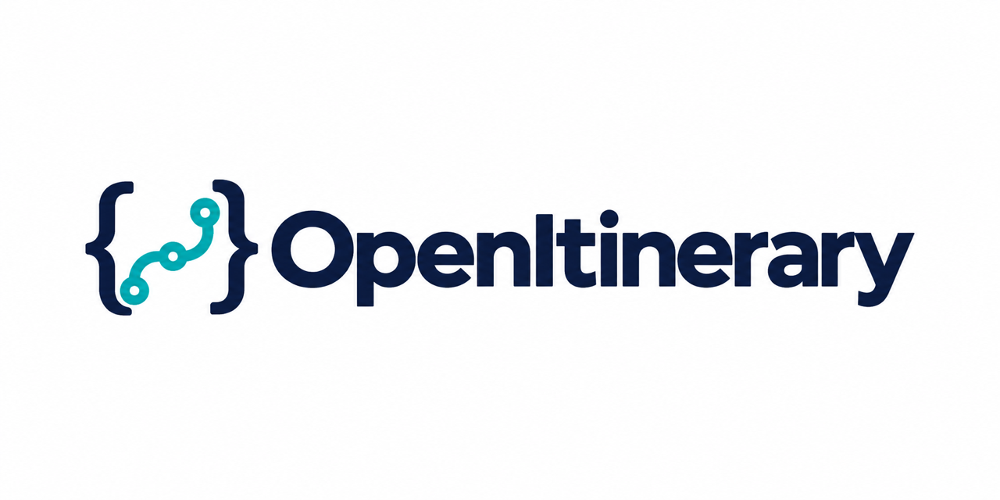
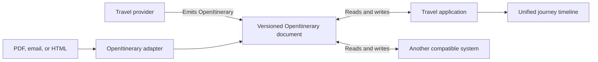
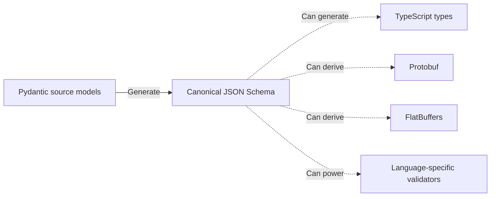

<h1 align="center">
  <picture>
    <source media="(prefers-color-scheme: dark)" srcset="assets/openitinerary-social-preview-dark.png" />
    <source media="(prefers-color-scheme: light)" srcset="assets/openitinerary-social-preview-light.png" />
    
  </picture>
</h1>

<p align="center">
  <a href="https://github.com/kiran94/openitinerary/actions/workflows/build.yml"></a>
  
</p>

<p align="center"><strong>An open, vendor-neutral standard for representing travel itineraries as structured data.</strong></p>

Combine flights, accommodation, rail journeys, transfers, activities, and tours
from different providers in one typed itinerary model—without coupling your
application to every proprietary format.

<p align="center">
  <a href="#quick-start">Quick Start</a> ·
  <a href="#examples">Explore Examples</a> ·
  <a href="schemas/0.1/itinerary.schema.json">Read the Schema</a> ·
  <a href="#convert-a-travel-document">Convert a Document</a> ·
  <a href="#ecosystem">Ecosystem</a>
</p>

## Why it matters

Travel applications often need to combine itinerary content from airlines,
hotels, booking platforms, emails, PDFs, and other sources. Each source has its
own format, forcing development teams to maintain source-specific models and
repeat integration logic.

OpenItinerary provides one vendor-neutral, strongly typed model for this data.
**Travel providers can produce it directly, while adapters can convert existing
documents when a provider does not yet support the standard**. Applications can
then build a unified journey timeline without proprietary format lock-in or
duplicating their core logic for every source.

For travellers, OpenItinerary-compatible applications can bring bookings from
different providers into one searchable, connected itinerary instead of
requiring separate apps, emails, and PDF documents.

## Choose your path

| I want to… | Start here |
| --- | --- |
| Integrate the standard in any language | Browse the [JSON Schema](schemas/0.1/itinerary.schema.json) and [example itineraries](examples/) |
| Create and validate itineraries in Python | Install the [Python package](#python-package) |
| Convert an existing PDF, email, or HTML booking | Run the [Adapter CLI](#convert-a-travel-document) |

## Quick start

### Validate an Itinerary

Validate a synthetic itinerary and read its timeline using the Python package.

From a checkout of this repository:

```bash
python -m pip install openitinerary
```

```python
from pathlib import Path
from openitinerary.models.itinerary import Itinerary

document = Path("examples/minimal-flight.json").read_text(encoding="utf-8")
itinerary = Itinerary.model_validate_json(document)

print(itinerary.title)

for segment in itinerary.segments:
    print(
        f"{segment.start_time_utc:%Y-%m-%d %H:%M} UTC"
        f" — {segment.title.values[0].value}"
    )
```

Output:

```text
A minimal flight itinerary from Tokyo to Manila
2027-03-03 09:00 UTC — Tokyo to Manila
```

`model_validate_json()` validates the document while constructing the typed
itinerary. Invalid fields or unsupported segment structures produce a Pydantic
validation error.

### Convert a Travel Document

Convert a PDF, HTML, or EML booking into validated OpenItinerary segments:

```bash
export OPENAI_API_KEY="your-api-key"

uvx --from 'openitinerary[adapters]' \
    openitinerary-adapt booking.pdf
```

Each extracted segment is written as JSON under `./converted`. Choose another
output directory with `--output-folder`.

> [!IMPORTANT]
> The adapter uses an LLM and may incur model-provider charges. Travel-document
> content is sent to the configured model provider, and web search may be used
> to enrich location coordinates. Review the provider's data-handling terms
> before processing personal or confidential documents.

## Who it helps

| Audience | What OpenItinerary enables |
| --- | --- |
| **Travel application developers** | Normalize content from different vendors and document formats into one typed model, then build a unified timeline without repeating core logic for every source. |
| **Travel providers** | Airlines, hotels, and booking platforms can emit OpenItinerary alongside their existing formats when sharing purchased itineraries or individual segments with customers and integration partners. |
| **Travellers** | Applications that support the same OpenItinerary schema version can combine bookings from different providers into one searchable, connected itinerary and exchange itinerary documents with other compatible systems using a shared format. This creates a path to portable travel data instead of leaving bookings scattered across apps, emails, and PDFs. |

## How it works

OpenItinerary supports direct adoption without requiring every provider to
adopt the standard immediately:



Providers can produce OpenItinerary alongside their existing formats. Where
that is not yet possible, adapters provide a practical migration path by
converting existing travel documents into typed segments.

Applications consume the same underlying document model regardless of its
source, allowing validated itineraries to be displayed, processed, and
exchanged consistently.

## Examples

Every example is synthetic and validated against the current OpenItinerary
model by the automated test suite.

| Example | What it demonstrates |
| --- | --- |
| [`minimal-flight.json`](examples/minimal-flight.json) | The smallest approachable itinerary: one flight from Tokyo to Manila. This is the document used by the Quick Start. |
| [`multi-provider-trip.json`](examples/multi-provider-trip.json) | A six-segment journey containing a flight, transfer, accommodation, activity, tour, and train in one ordered itinerary. |
| [`multilingual-trip.json`](examples/multilingual-trip.json) | English and Japanese names, travel between Singapore and Japan, and explicit local time zones. |

The examples are also useful as fixtures when evaluating an integration or
generating types from the JSON Schema. Because they are exercised by the test
suite, changes that make an example incompatible with the model fail
validation.

## Design principles

| Principle | Commitment |
| --- | --- |
| **Vendor neutral** | Model underlying travel concepts rather than the proprietary format of any particular provider. |
| **Open and interoperable** | Allow itinerary documents to move between systems and programming languages. |
| **Strongly typed** | Give fields explicit semantics. New concepts should evolve the standard rather than rely on arbitrary metadata escape hatches. |
| **Minimal core** | Define universal concepts in base models and keep domain-specific fields in specialized segment types. |
| **JSON as the minimum** | Provide a readable, widely supported interchange format while allowing equivalent representations such as Protobuf. |
| **Versioned** | Version the schema using semantic versioning so producers and consumers can identify compatibility. |
| **Canonical time** | Express segment times in UTC while retaining each place's IANA timezone for local presentation. |
| **International by design** | Associate human-readable text with its language so applications can select or translate the appropriate representation. |

## Standard and Tooling

The published contract for OpenItinerary is its
[JSON Schema](schemas/0.1/itinerary.schema.json). Applications can use the
schema directly from any language or platform with JSON Schema support.

This repository maintains the standard as Pydantic source models and generates
the canonical JSON Schema from them. The Python models are tooling for
maintaining and consuming the standard; using Python is not a requirement for
adopting OpenItinerary.



JSON is the minimum supported interchange format because it is widely
supported, readable, and straightforward to integrate. Alternative encodings
may be derived for particular use cases, but they must preserve the same model
semantics and schema version.

### Python Package

The optional Python package provides Pydantic models for creating and
validating OpenItinerary documents, together with a command for generating the
versioned JSON Schema.

Install it from PyPI:

```bash
python -m pip install openitinerary
```

Import the typed itinerary model:

```python
from openitinerary.models.itinerary import Itinerary
```

See the [Quick Start](#quick-start) for a complete validation example.

Generate the schema supplied by the installed package:

```bash
openitinerary --output stdout --indent
```

### Adapter API

Applications that need an HTTP interface can use the same document adapters
through the Adapter API.

Run the published container from GitHub Container Registry:

```bash
export OPENAI_API_KEY="your-api-key"

docker run --rm \
    --publish 8000:8000 \
    --env OPENAI_API_KEY \
    --env OTEL_SDK_DISABLED=true \
    ghcr.io/kiran94/openitinerary-adapter-api:latest
```

For local development, run the API from source:

```bash
export OPENAI_API_KEY="your-api-key"
export OTEL_SDK_DISABLED=true

make api
```

These examples disable OpenTelemetry export so they run without a collector.
See [Telemetry](#telemetry) to enable observability.

Interactive documentation is available at `http://127.0.0.1:8000/docs`.

Convert a document:

```bash
curl --fail --silent --show-error \
    --request POST \
    --form "file=@booking.pdf" \
    http://127.0.0.1:8000/api/v1/adapt/segment
```

The response is a JSON array containing the extracted OpenItinerary segments.

Uploaded documents are limited to 10 MiB by default:

| Environment variable | Description | Default |
| --- | --- | --- |
| `OPEN_ITINERARY_MAX_UPLOAD_SIZE_BYTES` | Maximum document upload size in bytes | `10485760` (10 MiB) |

## Core Concepts

- **`Itinerary`** — A versioned document containing an ordered collection of
  typed travel segments.
- **`Segment`** — A travel activity with a defined type, start time, and related
  places. Supported types currently include flights, trains, accommodation,
  transfers, activities, and tours.
- **`Place`** — A geographic location with a country, IANA timezone,
  coordinates, and localized name. Specialized place types add fields such as
  airport codes.
- **`MultilingualText`** — One or more text values identified by language and,
  optionally, region.

`BaseSegment` defines the fields shared by travel activities. Domain-specific
models such as `FlightSegment` and `AccommodationSegment` add their own fields
and validation without changing the common segment structure.

## Project Status

OpenItinerary is under active development and currently uses a pre-1.0 schema.
It is suitable for experimentation and early integrations, but consumers should
pin the schema version and expect the model to evolve.

### Available Today

- A versioned JSON Schema covering flights, trains, accommodation, transfers,
  activities, and tours.
- A Python package for creating, validating, and generating OpenItinerary
  documents and schemas.
- PDF, HTML, and email adapters.
- An Adapter CLI and HTTP API.
- Synthetic examples validated continuously against the model.

### Planned

- Car-rental, ferry, and cruise segments.
- Calendar and ZIP document adapters.
- A standalone JSON Schema package.
- A model-validation API.

## Ecosystem

OpenItinerary is the shared data standard at the centre of a set of
complementary projects exploring real-world travel-data workflows.

| Project | Role |
| --- | --- |
| **[OpenItinerary](https://github.com/kiran94/openitinerary)** | Defines the vendor-neutral schema and provides validation and document-conversion tooling. |
| **[OpenItinerary Batch Processing](https://github.com/kiran94/openitinerary-batch-processing)** | Processes travel documents asynchronously, with job tracking, object storage, worker orchestration, failure handling, and operational telemetry. |
| **[OpenItinerary Server](https://github.com/kiran94/openitinerary-server)** | Validates, stores, and serves OpenItinerary documents through a persistent HTTP API. |

These projects are separate components at different stages of maturity. They
demonstrate possible ways to build around the standard; none is required to
adopt the OpenItinerary format.

## Telemetry

The Adapter API emits logs, metrics, and traces through
[OpenTelemetry](https://opentelemetry.io/). Incoming requests receive
correlation IDs, while request handling and outbound HTTP calls are
instrumented for tracing.

Configure an OTLP-compatible collector using the standard OpenTelemetry
environment variables:

```bash
export OTEL_EXPORTER_OTLP_ENDPOINT="http://localhost:4318"
make api
```

See the [OpenTelemetry exporter configuration](https://opentelemetry.io/docs/languages/sdk-configuration/otlp-exporter/)
for endpoints, headers, and signal-specific settings.

Disable telemetry when running without a collector:

```bash
export OTEL_SDK_DISABLED=true
```

## Versioning and Releases

OpenItinerary maintains two related but independent versions:

| Version | Defined in | Changes when |
| --- | --- | --- |
| **Schema version** | `OPEN_ITINERARY_VERSION` in `src/openitinerary/version.py` | The portable itinerary model changes |
| **Distribution version** | `pyproject.toml` | Python tooling, adapters, or the schema are released |

A tooling or adapter change can therefore produce a new package and container
release without changing the schema version.

### Schema Compatibility

Schema versions follow semantic versioning:

- **Major:** breaking changes to the model.
- **Minor:** backwards-compatible additions.
- **Patch:** corrections to schema documentation or metadata.

Generated schema directories use the major and minor version, such as
`schemas/0.1/itinerary.schema.json`. Patch releases update the schema file for
that compatibility line rather than creating another directory.

Consumers should inspect `schema_version` and explicitly support the schema
versions their application understands.

### Creating a Release

Update the distribution version with `uv` so `pyproject.toml` and `uv.lock`
remain synchronized:

```bash
uv version --bump patch --no-sync
```

Use `minor` or `major` when appropriate. If the standard changed, also update
`OPEN_ITINERARY_VERSION` and regenerate the committed schema:

```bash
make generate_out
```

Pull requests publish beta Python packages for testing. When a
distribution-version change reaches `main`, CI publishes the stable Python
package and versioned Adapter API container. Changes that do not update the
distribution version are built and tested without creating another stable
release.

## Contributing

Contributions are welcome across the schema, examples, adapters, and supporting
tooling.

Because schema changes affect every producer and consumer, proposals should
describe the underlying travel concept, explain why the current model cannot
represent it, and consider whether it applies across multiple vendors.
Provider-specific metadata escape hatches are intentionally avoided.

Before submitting a change, run the same core checks used by CI:

```bash
uv sync --locked --all-extras --dev
make format
make test
make build
```

Changes to the standard must also regenerate the committed JSON Schema:

```bash
make generate_out
```

## License

Copyright 2026 Kiran Patel.

Licensed under the [Apache License, Version 2.0](LICENSE).
