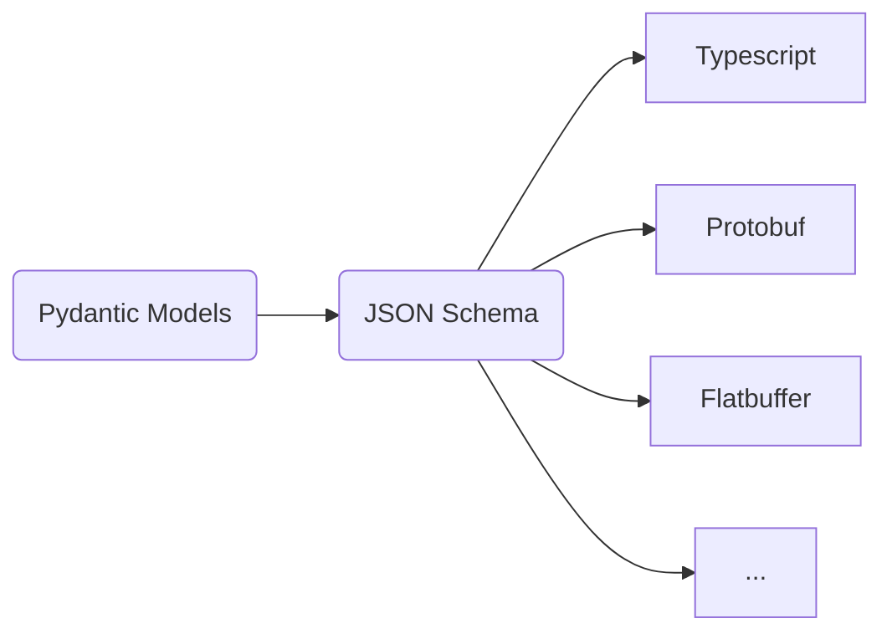

# OpenItinerary

OpenItinerary is an open, vendor-neutral standard for representing travel itineraries as structured data.

Inspired by JSON in the data exchange space, OpenItinerary facilitates a common specification that any travel company can produce or consume without relying on proprietary formats. A single itinerary can contain flights, trains, accommodation and other travel related activities from various vendors within a single unified model.

Principles:
* Vendor Neutral: No dependency on any particular vendor proprietary format. Instead model the underlying travel concepts.
* Open & Interoperable: Designed to move cleanly between systems and programming languages.
* Strongly Typed: Fields have clear semantics and avoid ambiguity. Missing concept and fields should be proposed to be added to the standard and there should be no custom metadata "escape hatches".
* Minimal: Universal Concepts are defined at the base models and domain specifics belong in specialized types.
* Serialization Friendly: Data model will at *minimum* map cleanly to JSON.
* Versioning: Schema is versioned and follows standard semantic versioning rules.
* Single Canonical Time: Date/Times are *always* stored in UTC format. Geographic Places will always store the Time zone in which they take place. Downstream applications are responsible for ensuring that time presented correctly.
* Internationalization: International differences are handled explicitly. Textual fields will store the language they are stored in so that downstream applications can present/provide translation when needed.

## Implementation

The schema is defined and maintained using *Pydantic Models* however this does not mean that OpenItinerary is a python project. These models are used to generate a **JSON Schema** which serves as the canonical schema of the project.

JSON is the default interchange format because it is universal, readable, and easy to integrate. From this format, other formats can be derived:



*Performance sensitive consumers may want to use binary formats such as Protobuf so the standard only states that JSON is a minimum supported format. Binary formats must represent the same model.*

### Python package

Install the Python package from PyPI:

```bash
python -m pip install openitinerary
```

Import models from the `openitinerary` package:

```python
from openitinerary.models.itinerary import Itinerary
```

Generate the current JSON Schema with the installed command:

```bash
openitinerary --output stdout
```

### Adapter API configuration

The Adapter API limits each uploaded document to 10 MiB by default. Set
to a positive integer to configure the
limit in bytes. The value is loaded when the API process starts, so restart the
process after changing it.

#### Environment Variables

| Name                                   | Description                                              | Default                 |
| -------------------------------------- | -------------------------------------------------------- | ----------------------- |
| `OPEN_ITINERARY_MAX_UPLOAD_SIZE_BYTES` | Maximum size of an uploaded document to the `/adapt` API | `10485760` bytes (10MB) |

## Concepts

* `Itinerary`: An itinerary is an ordered collection of typed segments.
* `Segment`: A travel activity that happens at a specified time at a specific place.
* `Place`: A geographical location on the earth.

The `BaseSegment` defined common concepts for all travel related activities and domain specific models such as `FlightSegment` add stronger fields and validation.

## Roadmap

**Schema**
  - [x] Base Segment Types
  - [x] Flights and Airports
  - [x] Train and Train Stations
  - [x] Accommodation
  - [x] Transfers
  - [x] Activities and Tours
  - [ ] Car Rentals
  - [ ] Ferries
  - [ ] Cruises

**Implementations**
 - [x] PDF Adapter
 - [x] HTML Adapter
 - [x] Email Adapter
 - [ ] Calender Adapter
 - [ ] ZIP Adapter
 - [ ] Model Validation API
 - [x] Adapter API
 - [ ] Python Package
 - [ ] JSON Schema Package
 - [ ] Batch Ingestion & Job Processing Service
